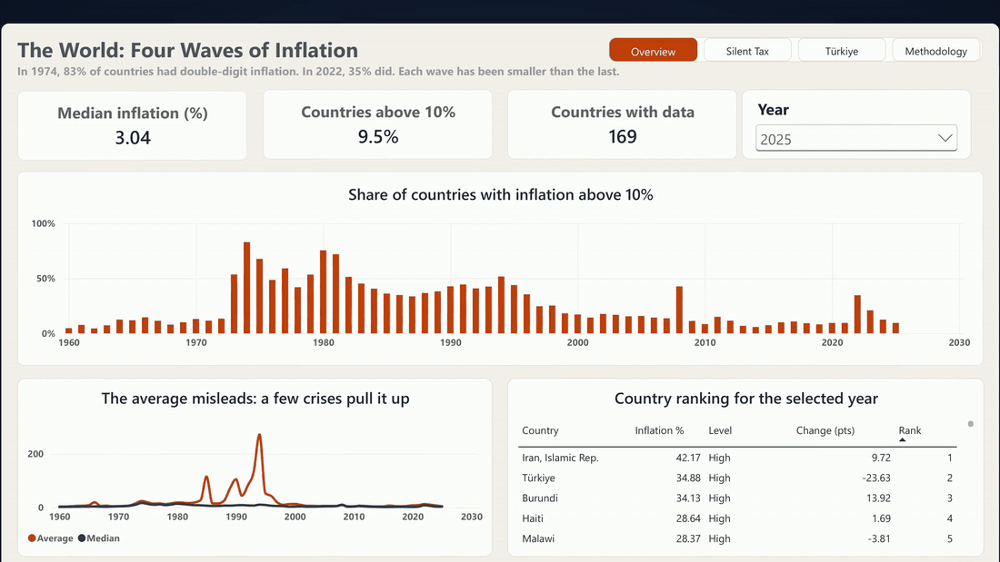
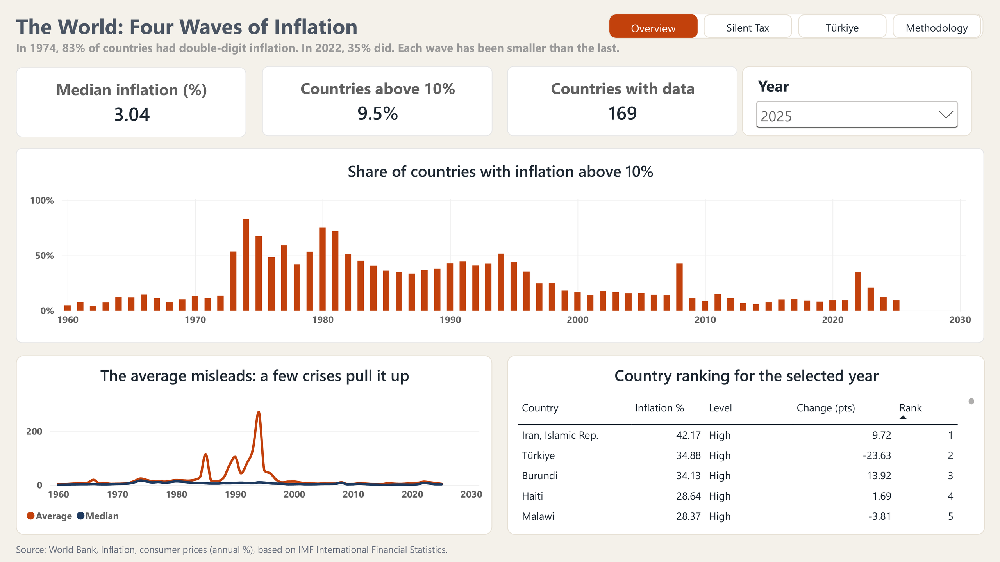
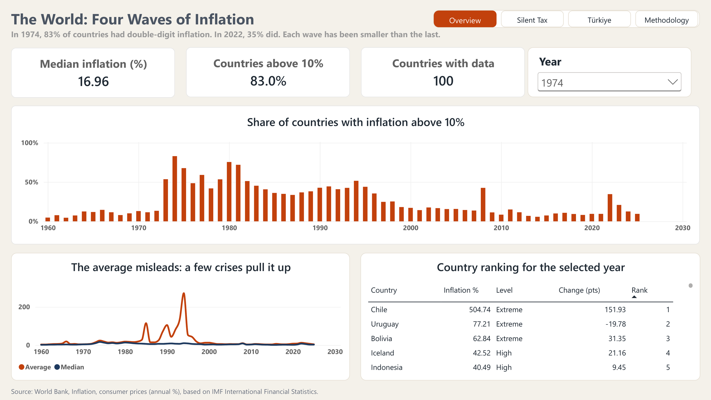
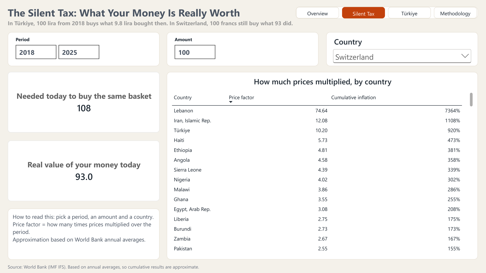
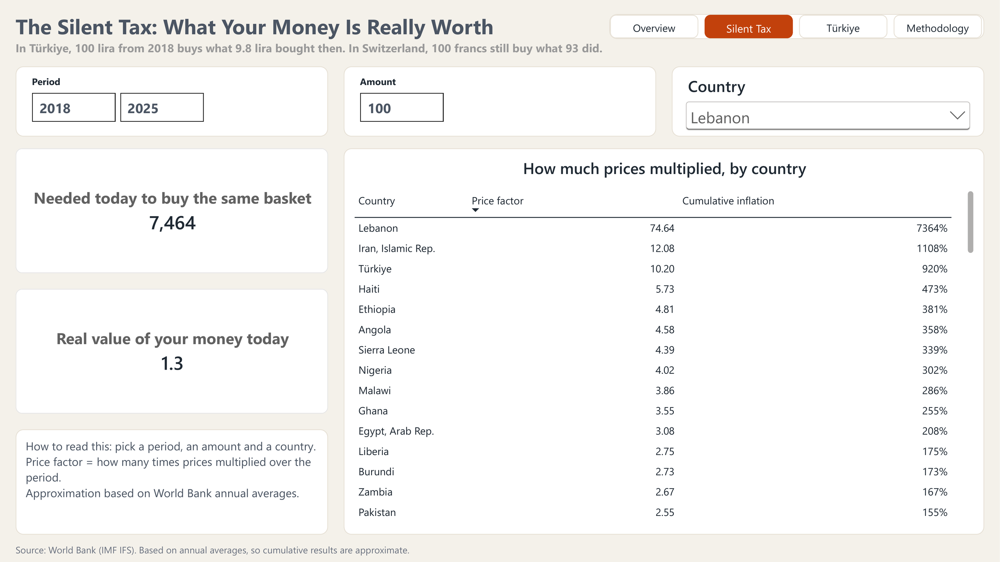
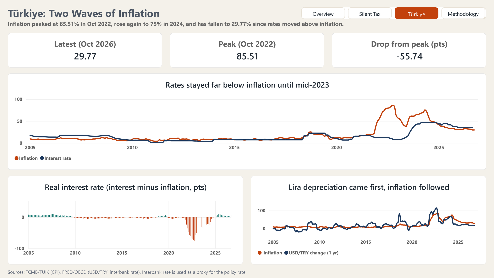
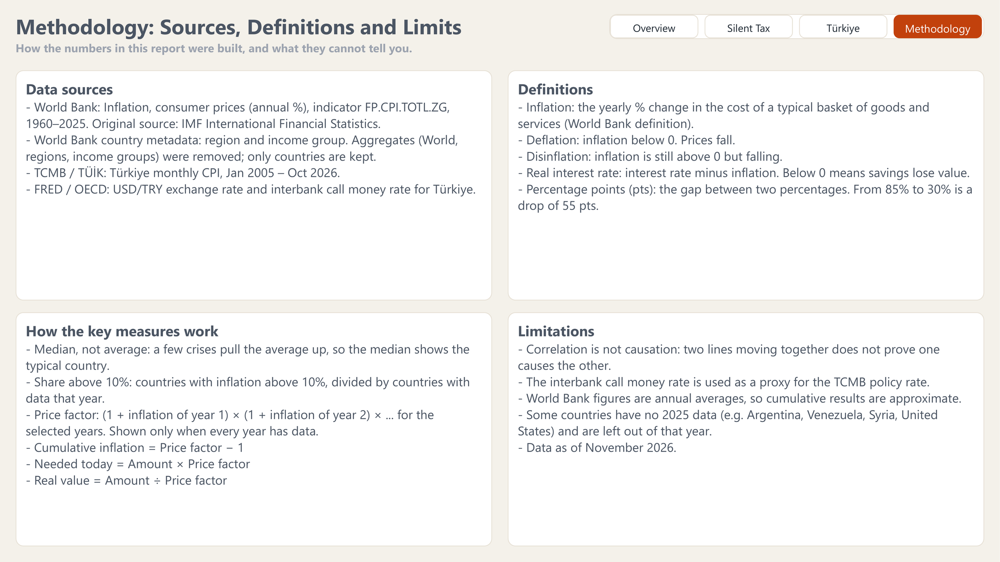
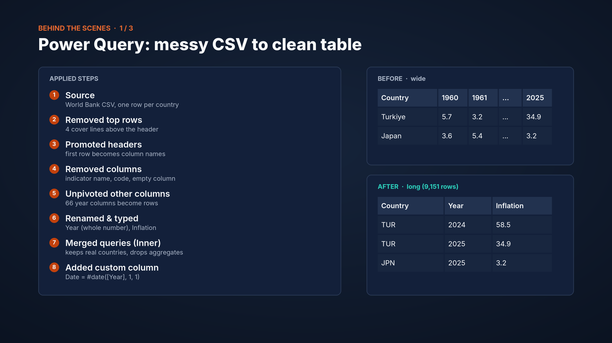
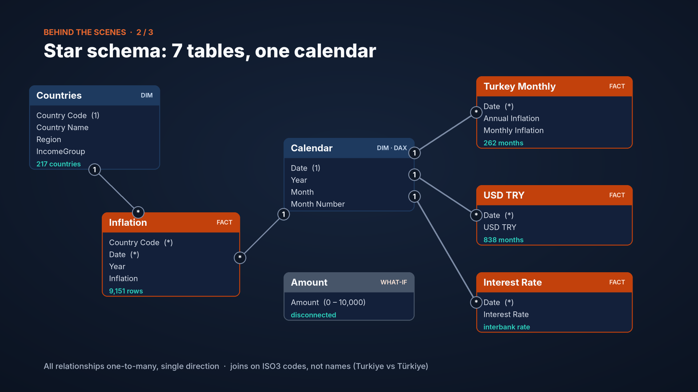
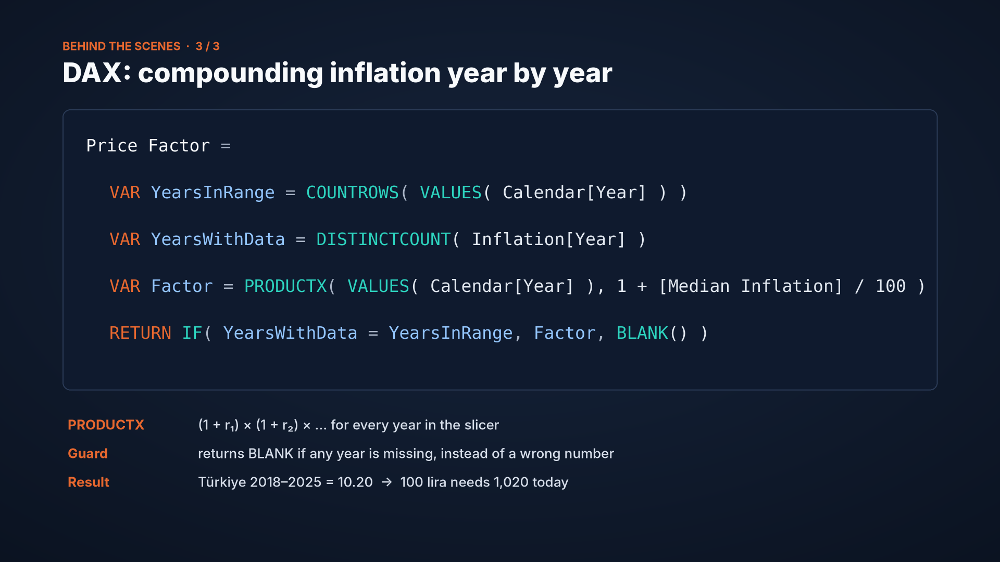

# The Silent Tax: How Inflation Quietly Eats Your Money

An end-to-end **Power BI** project on 65 years of inflation data for **193 countries**, with a deep dive into **Türkiye**.
Built from scratch: Power Query cleaning, a star-schema data model, 25 DAX measures and a four-page report.



> **Video walkthrough:** see the LinkedIn post on [my profile](https://www.linkedin.com/in/sultan-akoushali).
> **Report as PDF:** [report/The_Silent_Tax_Report.pdf](report/The_Silent_Tax_Report.pdf)

---

## Key insights

| # | Finding | Where |
|---|---|---|
| 1 | **Four global waves of inflation, each smaller than the last.** In 1974, 83% of countries had double-digit inflation. In 2022, 34.6% did. | Overview |
| 2 | **2022 was a sudden wave:** the share of countries above 10% jumped from 9.5% in 2021 to 34.6% in 2022. | Overview |
| 3 | **The average misleads.** In 1994 the average country inflation was 272%, while the median was 10.25%. A few hyperinflations pull the average up, so the report uses the median. | Overview |
| 4 | **Türkiye ranked #2 of 169 countries in 2025** at 34.9%, behind Iran (42.2%), but 23.6 points lower than in 2024. | Overview |
| 5 | **The silent tax, 2018–2025:** prices multiplied 74.6× in Lebanon, 12.1× in Iran and 10.2× in Türkiye. 100 lira from 2018 now buys what 9.8 lira bought then. In Switzerland, 100 francs still buy what 93 did. | Silent Tax |
| 6 | **Türkiye's monthly inflation peaked at 85.51% (Oct 2022)** and fell to 29.77% by Oct 2026, a drop of 55.74 points. | Türkiye |
| 7 | **Interest rates stayed far below inflation until mid-2023.** Real rates were deeply negative through 2022 and turned positive in late 2024. | Türkiye |
| 8 | **Lira depreciation came first, inflation followed** (2018, late 2021, mid-2023). This is a correlation, not proof of causation. | Türkiye |

---

## Report pages

### 1. Overview: The World

One **Year** slicer drives every card, the ranking table and the year-over-year change. Same page in 1974:


### 2. The Silent Tax

Pick a **period**, an **amount** (What-if parameter) and a **country**. The report compounds inflation year by year and answers two questions: how much you need today to buy the same basket, and what your old money is really worth.

| Switzerland, 2018–2025 | Lebanon, 2018–2025 |
|---|---|
|  |  |

### 3. Türkiye: Two Waves of Inflation

Monthly CPI (TCMB) against the interbank interest rate and the USD/TRY exchange rate.

### 4. Methodology

Sources, definitions, how each measure works, and the limits of the data.

---

## How it was built

### Power Query


- World Bank CSV: removed 4 cover lines, promoted headers, removed indicator columns, **unpivoted 66 year columns** into rows, typed the columns.
- **Inner merge** with the country metadata on the ISO3 code to keep real countries and drop regional and income-group aggregates (World, Euro area, etc.).
- Added a `Date` column with `#date([Year], 1, 1)` to connect to the calendar.
- Türkiye monthly CPI loaded **from the TCMB web page** (HTML table). USD/TRY and the interbank rate loaded **from FRED CSV links**.

### Data model


- Star schema: `Calendar` (DAX table, marked as date table) and `Countries` as dimensions; `Inflation`, `Turkey Monthly`, `USD TRY` and `Interest Rate` as fact tables.
- All relationships one-to-many, single direction. Keys hidden in the fact tables. Auto date/time turned off.
- Joins use ISO3 codes, not names, because the data file says *Turkiye* while the metadata says *Türkiye*.
- `Amount` is a disconnected What-if parameter (0 to 10,000).

### DAX (selected measures)


```DAX
Median Inflation = MEDIAN( Inflation[Inflation] )

Countries Reporting   = DISTINCTCOUNT( Inflation[Country Code] )
Countries Above 10%   = CALCULATE( [Countries Reporting], Inflation[Inflation] > 10 )
% Countries Above 10% = DIVIDE( [Countries Above 10%], [Countries Reporting] )

Change vs LY =
IF( ISBLANK( [Median Inflation] ) || ISBLANK( [Median Inflation LY] ), BLANK(),
    [Median Inflation] - [Median Inflation LY] )

Rank = IF( ISBLANK( [Median Inflation] ), BLANK(), RANKX( ALL( Countries ), [Median Inflation], , DESC ) )

Price Factor =
VAR YearsInRange  = COUNTROWS( VALUES( Calendar[Year] ) )
VAR YearsWithData = DISTINCTCOUNT( Inflation[Year] )
VAR Factor        = PRODUCTX( VALUES( Calendar[Year] ), 1 + [Median Inflation] / 100 )
RETURN IF( YearsWithData = YearsInRange, Factor, BLANK() )

Needed Today = [Amount Value] * [Price Factor]
Real Value   = DIVIDE( [Amount Value], [Price Factor] )

TR Real Rate =
IF( ISBLANK( [TR Interest Rate] ) || ISBLANK( [TR Annual Inflation] ), BLANK(),
    [TR Interest Rate] - [TR Annual Inflation] )
```

A recurring lesson: DAX treats BLANK as 0 in arithmetic, so every measure that combines two values guards both sides with `ISBLANK`.

---

## Data sources

| Data | Source | Coverage |
|---|---|---|
| Inflation, consumer prices (annual %), `FP.CPI.TOTL.ZG` | [World Bank](https://data.worldbank.org/indicator/FP.CPI.TOTL.ZG), based on IMF International Financial Statistics | 1960–2025 |
| Country region and income group | World Bank country metadata | 217 economies |
| Türkiye monthly CPI (annual and monthly change) | TCMB / TÜİK | Jan 2005 – Oct 2026 |
| USD/TRY exchange rate (`CCUSMA02TRM618N`) | [FRED](https://fred.stlouisfed.org/series/CCUSMA02TRM618N) / OECD | 1957 – Oct 2026 |
| Interbank call money rate (`IRSTCI01TRM156N`) | [FRED](https://fred.stlouisfed.org/series/IRSTCI01TRM156N) / OECD | 1986 – Aug 2026 |

The World Bank files are in [`data/`](data) (licensed CC BY 4.0 by the World Bank). The Türkiye series are loaded directly from the web inside the `.pbix`.

## Limitations

- **Correlation is not causation.** Lines moving together do not prove one causes the other.
- The **interbank call money rate** is used as a proxy for the TCMB policy rate.
- World Bank figures are **annual averages**, so cumulative results are approximate and differ from December-to-December figures.
- Some countries have no 2025 data (for example Argentina, Venezuela, Syria and the United States) and are left out of that year.

## How to open

1. Download [`The_Silent_Tax.pbix`](The_Silent_Tax.pbix) and open it in Power BI Desktop (free).
2. To refresh, point the three World Bank queries to the CSV files in `data/` (Transform data → Data source settings).
3. In Power BI Desktop, hold **Ctrl** and click the navigation buttons to move between pages.

Theme: [`theme/SilentTax_Theme.json`](theme/SilentTax_Theme.json).

## Tools

Power BI Desktop · Power Query (M) · DAX · Star-schema modeling · What-if parameters · Custom report theme

---

**Sultan Akoushali** · Data Analyst · [LinkedIn](https://www.linkedin.com/in/sultan-akoushali) · [Portfolio](https://sultan-akoushali.github.io)
